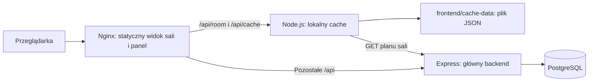

# Plan sal na tabletach — dokumentacja projektu

Projekt wyświetla dzienny plan sali, pozwala zarządzać harmonogramem i zachowuje pobrane plany w lokalnych plikach JSON. Dwa niezależne pakiety wdrożeniowe to `backend/` oraz `frontend/`.

Dokumentacja opisuje kod gałęzi `zpi/frontend/1.11.2026-V1.10` z 2026-11-01. Przykładowe adresy, ID i tokeny zastąp wartościami swojej instalacji. Nazwa lokalnego folderu może nadal zawierać `V1.9`; wersję sprawdzaj przez `git branch --show-current` i `git log -1`.

## Spis dokumentacji

| Potrzeba | Dokument |
| --- | --- |
| Całość, uruchomienie, komunikacja i awarie | Ten plik |
| Instalacja i utrzymanie głównego API | [Backend](backend/README.md) |
| Endpointy, parametry, odpowiedzi i walidacja | [API backendu](backend/docs/API.md) |
| Wszystkie pliki i funkcje backendu | [Kod backendu](backend/docs/KOD.md) |
| Tabele, migracje, seed i kopie PostgreSQL | [Baza danych](backend/database/README.md) |
| Instalacja widoku sali, panelu i cache | [Frontend](frontend/README.md) |
| Obsługa ekranów i panelu administratora | [Użytkowanie](frontend/docs/UZYTKOWANIE.md) |
| Trwałość JSON, algorytm i API kopii | [Cache](frontend/docs/CACHE.md) |
| Pliki, komponenty, hooki i funkcje frontendu | [Kod frontendu](frontend/docs/KOD.md) |
| Pełny spis plików repozytorium | [Indeks plików](docs/PLIKI.md) |
| Testy i granice sprawdzenia | [Weryfikacja](docs/WERYFIKACJA.md) |

## Architektura



Przeglądarka domyślnie łączy się wyłącznie z serwerem frontendu. Nginx przekazuje odczyt planu do `cache`, a żądania panelu do głównego API. Cache pobiera poprawne plany z API i zapisuje je na dysku. Interfejsy React są statycznymi plikami; JSON zapisuje osobny proces Node.js. Przeglądarka nie łączy się z PostgreSQL.

| Usługa | Odpowiedzialność | Port kontenera | Port hosta domyślnie | Trwałe dane |
| --- | --- | --- | --- | --- |
| `frontend` | Nginx, dwa interfejsy i proxy | 80 | 5173 | Pliki interfejsu w obrazie |
| `cache` | Pobranie, walidacja, zapis i kopie planów | 3002 | Niepublikowany | Bind mount `frontend/cache-data/` → `/data` |
| `backend` | Publiczne API i administracja | 3001 | 3001 | Dane w PostgreSQL |
| `database` | PostgreSQL 16 | 5432 | Niepublikowany | Nazwany wolumen `postgres-data` |

Główne Compose łączy frontend, cache i API przez `public_net`, a API i bazę przez wewnętrzną `data_net`. Jawne nazwy sieci to `room-tablet-public-net` i `room-tablet-data-net`. Cache nie potrzebuje dostępu do bazy.

## Całość na jednym komputerze

Wymagane: działający Docker, BuildKit i Compose v2 obsługujący `--wait`. Windows: Docker Desktop w trybie kontenerów Linux. Polecenia wykonuj z katalogu tego README.

Przy pierwszej instalacji utwórz `.env` (nie nadpisuj istniejących ustawień):

```bash
cp .env.example .env
```

PowerShell: `Copy-Item .env.example .env`. Edytuj plik, np.:

```dotenv
FRONTEND_PORT=5173
BACKEND_PORT=3001
BACKEND_URL=http://backend:3001
ADMIN_TOKEN=wstaw-wlasny-dlugi-token-panelu
CACHE_ADMIN_TOKEN=wstaw-wlasny-dlugi-token-kopii
APP_TIMEZONE=Europe/Warsaw
CORS_ORIGIN=http://localhost:5173
TABLET_ROOM_ID=205
CACHE_ROOM_IDS=205,30
CACHE_REFRESH_SECONDS=60
CACHE_TIMEOUT_SECONDS=5
```

`BACKEND_URL` musi być osiągalny z kontenerów frontendu i cache, bez `/api` i końcowego `/`. Nazwa `backend` działa w sieci wspólnego Compose. `.env` jest źródłem podstawień w Compose; dowolna dopisana zmienna nie trafia automatycznie do kontenera.

```bash
docker compose config --quiet
docker compose up -d --build --wait
docker compose ps
```

Migracje wykonują się przy starcie API. **Nowa baza jest pusta** — samo uruchomienie nie dodaje sal. Opcjonalne dane demonstracyjne:

```bash
docker compose exec -T backend npm run db:seed
```

Seed usuwa dane aplikacji i tworzy od nowa pięć sal z 25 zajęciami na dzień uruchomienia. Używaj go, gdy świadomie chcesz zastąpić zawartość bazy. Przygotowanie instalacji bez seeda: [baza danych](backend/database/README.md).

Adresy:

- `http://localhost:5173/` — sala z `TABLET_ROOM_ID`;
- `http://localhost:5173/room/205` — sala o kodzie `205`;
- `http://localhost:5173/admin/` — panel, logowanie przez `ADMIN_TOKEN`;
- `http://localhost:3001/api/health` — API i połączenie z bazą;
- `http://localhost:5173/healthz` — sam Nginx.

Na tablecie zamiast `localhost` wpisz adres serwera, np. `http://192.168.1.10:5173/room/205`. Dostosuj sieć i `CORS_ORIGIN`. Dostarczone Compose publikuje porty na interfejsach hosta; lokalny override może to zmieniać.

## Dwa osobne serwery

Na serwer API skopiuj całe `backend/`, przygotuj jego `.env` z `ADMIN_TOKEN`, `CORS_ORIGIN` i ewentualnie `BACKEND_PORT`, a następnie uruchom Compose z tego katalogu. Szczegóły: [backend](backend/README.md).

Na serwer WWW skopiuj całe `frontend/`, przygotuj jego `.env`, np. `BACKEND_URL=http://192.168.1.20:3001` i własny `CACHE_ADMIN_TOKEN`, następnie uruchom jego Compose. Szczegóły: [frontend](frontend/README.md). Tablet potrzebuje połączenia z WWW; serwer WWW z API. `localhost` nie oznacza innej maszyny.

Każdy pakiet można wdrożyć bez drugiego katalogu. Główne Compose uruchamia razem cztery usługi, a podkatalogi mają własne Compose. Domyślne nazwy projektów: `tablet_app_web`, `tablet_app_backend`, `tablet_app_frontend`. Główne Compose ma stałe `container_name`; równoległe instalacje na jednym hoście wymagają osobnych nazw kontenerów, sieci i portów. Samo `-p` nie zmienia jawnych nazw kontenerów ani sieci.

## Awarie i trwałość

| Sytuacja | Zachowanie |
| --- | --- |
| Backend lub jego baza nie odpowiada | Pobrany plan może być serwowany z JSON z ostrzeżeniem; panel nie zapisuje zmian |
| Restart frontendu bez backendu | Plan działa po zachowaniu folderu `cache-data/` i tego samego źródła `BACKEND_URL` |
| Sala/data nigdy niepobrana | Cache nie odtworzy brakujących danych; zwykle odpowiada 503 |
| API odpowiada 401/403/404 | Cache zachowuje błąd; 404 usuwa zapisy tej sali |
| Zmiana dnia bez połączenia | Możliwy ostatni wcześniejszy plan z ostrzeżeniem i właściwą datą; jawnej daty nie zastępuje się inną |
| Cache zatrzymany | Nowy odczyt nie działa; otwarta karta może zachować ostatnie dane w RAM |
| Nginx lub serwer WWW wyłączony | Nowe otwarcie i przeładowanie strony nie działa; brak service workera i instalowanej kopii aplikacji offline |
| Własny endpoint w oknie API | Przeglądarka odpytuje go bezpośrednio; serwerowy cache nie uczestniczy w tym połączeniu |

Import JSON zasila lokalny cache. Nie zapisuje danych do PostgreSQL, nie odtwarza pełnej bazy i nie synchronizuje zmian administracyjnych po awarii. Nie ma automatycznego wysyłania backupu do dużego serwera.

## Codzienna obsługa

W katalogu wybranego Compose:

```bash
docker compose logs --tail=100 frontend cache backend
docker compose stop backend
docker compose up -d backend
docker compose down
```

W samodzielnym pakiecie podaj tylko istniejące usługi. `down` zachowuje bazę i folder cache. `down -v` usuwa zarządzane nazwane wolumeny, w tym bazę; nie usuwa bind mountu.

Po zmianie kodu użyj `docker compose up -d --build --wait`. Po zmianie `BACKEND_URL`: `docker compose up -d --force-recreate frontend cache`. Po zmianie `ADMIN_TOKEN` odtwórz backend oraz cache, jeśli dziedziczy token panelu. `TABLET_ROOM_ID` wymaga przebudowania frontendu. Sam `restart` nie wczytuje nowej konfiguracji Compose.

Przed aktualizacją zachowaj kopię [PostgreSQL](backend/database/README.md#kopia-i-odtworzenie-bazy) i [JSON](frontend/docs/CACHE.md#eksport-i-import). Migracje nie mają automatycznego cofania; powrót do starego obrazu może wymagać zgodnej kopii bazy.

## Pliki głównego katalogu

| Plik | Rola |
| --- | --- |
| `README.md` | Punkt wejścia i instrukcja wspólnego wdrożenia |
| `docker-compose.yml` | Cztery usługi, porty, sieci, healthchecki i magazyny danych |
| `.env.example` | Wzór ustawień; faktyczne sekrety są w ignorowanym `.env` |
| `.gitignore` | Wyklucza zależności, buildy, sekrety, JSON i lokalny override |
| `DZIENNIK_PRAKTYK_27.10.2025-21.04.2026.md` | Historyczny dziennik praktyk, nie instrukcja bieżącego wdrożenia |
| `docs/PLIKI.md` | Indeks wszystkich plików wersjonowanych i dokumentacji |
| `docs/WERYFIKACJA.md` | Zakres testów i procedury sprawdzenia |

Lokalny `docker-compose.override.yml`, jeśli istnieje, jest automatycznie łączony z główną konfiguracją. Nie jest częścią repozytorium. Samą konfigurację repo sprawdzisz przez `docker compose -f docker-compose.yml config --quiet`.

Stos: Node.js 22, Express 4, Prisma 7, PostgreSQL 16, React 18, React Router 7, TypeScript, Vite 5, Tailwind CSS 3 i Nginx. Dokładne wersje bibliotek utrwalają trzy `package-lock.json`. Obrazy bazowe mają tagi, nie digesty. Repozytorium nie zawiera pliku licencji ustanawiającego dodatkowe warunki użycia.
