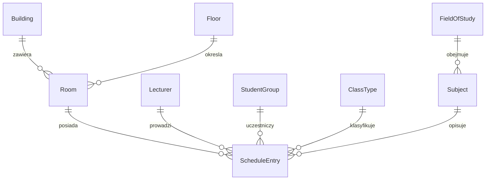

# PostgreSQL i Prisma

[Backend](../README.md) · [API](../docs/API.md) · [Funkcje](../docs/KOD.md)

PostgreSQL jest pełnym źródłem danych aplikacji. Cache JSON zawiera wyłącznie wybrane pobrane plany. Usługa bazy używa `postgres:16-alpine`, nazwanego wolumenu i nie publikuje portu na hoście.

## Model i relacje

Źródło: [schema.prisma](../prisma/schema.prisma). Nazwy modeli Prisma są w PascalCase, kolumny SQL zwykle snake_case, a odpowiedzi administratora zwykle camelCase.



Wszystkie encje mają liczbowe `id` z autoincrement. Słowniki mają `isActive=true` oraz `createdAt`, `updatedAt` jako `timestamptz(6)`; `updatedAt` jest obsługiwane przez Prisma (`@updatedAt`), nie przez trigger SQL. `Room` ma obie daty, bez flagi aktywności. `ScheduleEntry` ma wyłącznie `createdAt`.

| Model / tabela | Pola specyficzne i unikalność deklarowane w Prisma |
| --- | --- |
| `Building` / `buildings` | `name` varchar(120), unique |
| `Floor` / `floors` | `label` varchar(80), unique; `sortOrder` integer domyślnie 0 |
| `Lecturer` / `lecturers` | `fullName` / `full_name` varchar(160), unique |
| `StudentGroup` / `student_groups` | `name` varchar(160), unique |
| `ClassType` / `class_types` | `name` varchar(120), unique |
| `FieldOfStudy` / `fields_of_study` | `name` varchar(180), unique |
| `Subject` / `subjects` | `code` varchar(64), unique; `name` varchar(200); `fieldOfStudyId`; unique `(name, fieldOfStudyId)` |
| `Room` / `rooms` | `roomCode` varchar(32), unique; `displayName` varchar(120); `buildingId`, `floorId` |
| `ScheduleEntry` / `schedule_entries` | `roomId`, `eventDate` date; `lecturerId`, `studentGroupId`, `classTypeId`, `subjectId`; `title` varchar(200); `startTime`, `endTime` time(6); `description` text; `note` text nullable |

**Różnica między schematem Prisma a wdrożonymi migracjami:** `Room.displayName` deklaruje varchar(120), a `ScheduleEntry.title` varchar(200), lecz dołączona sekwencja migracji pozostawia `rooms.display_name` i `schedule_entries.title` jako SQL `TEXT`. Kontroler sali nadal wymaga nazwy do 120 znaków, a tytuł wpisu powstaje z nazwy przedmiotu ograniczonej do 200. Nie zakładaj jednak tych dwóch limitów jako fizycznych ograniczeń bazy utworzonej przez `migrate deploy`. To istniejąca rozbieżność projektu, wymagająca osobnej migracji, jeśli ma zostać usunięta; dokumentacja nie zmienia danych ani historii SQL.

Każda relacja FK ma `onDelete: Restrict`, `onUpdate: Cascade`. Zależny rekord blokuje usuwanie. Jawna opcja kaskadowa API sali najpierw usuwa wpisy aplikacyjnie. Flaga nie zmienia definicji FK. Piętra są globalnym słownikiem, nie mają `buildingId`. Skrzydeł nie ma w aktualnym modelu.

Indeksy: `idx_rooms_building`, `idx_rooms_floor`, `idx_subjects_field`, `idx_schedule_entries_room_day` na `(roomId,eventDate,startTime)`, a także indeksy prowadzącego, grupy, typu i przedmiotu. Klucze unikalne tworzą własne indeksy. SQL migracji zawiera CHECK `start_time < end_time`, którego sam plik Prisma nie wyraża. Nie ma constraintu wykluczającego nakładające się przedziały.

Daty i godziny są logicznymi wartościami lokalnymi. `Date` używane przez Prisma dla SQL DATE/TIME jest konwertowane helperami UTC, aby uniknąć przypadkowego przesunięcia podczas serializacji. Nie oznacza to, że 08:00 jest godziną UTC. Bieżący dzień i statusy wynikają z `APP_TIMEZONE`. Brak reguł cyklicznych: każdy wpis ma konkretną datę.

## Inicjalizacja i role

Przy **pierwszym starcie pustego wolumenu** oficjalny obraz PostgreSQL tworzy bazę `tablet_schedule` i użytkownika `admin` z konfiguracji Compose, potem wykonuje `database/init/`:

- [001_schema.sql](init/001_schema.sql) jest informacją, że strukturą zarządza Prisma; nie tworzy tabel;
- [002_web_app_role.sql](init/002_web_app_role.sql) tworzy lub aktualizuje rolę `web_app` z hasłem demonstracyjnym, daje CONNECT do `tablet_schedule` i USAGE schematu public.

Migracje uruchamiane później przez backend tworzą tabele i uprawnienia SELECT dla `web_app`, również domyślne uprawnienia dla nowych tabel tworzonych przez rolę migracyjną. Administrator utworzony przez `POSTGRES_USER` ma szerokie prawa i obsługuje migracje, seed i panel. Publiczne repozytoria korzystają z `prisma`/`DATABASE_URL`, administracyjne z `prismaAdmin`/`DATABASE_ADMIN_URL`.

Oba klienty używają `@prisma/adapter-pg` i pul `pg`. Gdy oba URL są identyczne, klient/pula są współdzielone. Zrównanie adresów administracyjnym URL odbiera rozdzielenie uprawnień. Dla istniejącej bazy samo ponowne uruchomienie kontenera nie wykonuje skryptów init. Wymagana rola i jej uprawnienia muszą już istnieć albo zostać nadane przez administratora.

## Migracje

[prisma.config.ts](../prisma.config.ts) wskazuje schemat, katalog migracji, polecenie seed i adres `DATABASE_URL`. Skrypt wdrożeniowy podmienia go na `DATABASE_ADMIN_URL`.

| Katalog w `prisma/migrations/` | Kolejny etap |
| --- | --- |
| `20260329183000_init/migration.sql` | Sale i wpisy z tekstowymi opisami słowników, indeks dnia/sali, CHECK czasu, początkowe FK i uprawnienia odczytu |
| `20260329194000_normalize_reference_entities/migration.sql` | Tworzy słowniki i relacje, przenosi dane z tekstów, zmienia FK na RESTRICT, dodaje indeksy i uprawnienia |
| `20260330120000_remove_wings_entity/migration.sql` | Usuwa encję wings, zachowując na tym etapie tekst `rooms.wing` |
| `20260330130000_drop_room_wing_column/migration.sql` | Usuwa również tekstową kolumnę wing |
| `migration_lock.toml` | Utrwala dostawcę `postgresql` |

W normalizacji brakujący kierunek staje się „Nieprzypisany kierunek”, a brakujący kod przedmiotu `AUTO-` + pierwsze 12 znaków MD5 z małymi literami tytułu i kierunku. Nie edytuj historycznych migracji w celu dopasowania ich do obecnego schematu — cała sekwencja musi pozostawać odtwarzalna.

W kontenerze: `docker compose exec -T backend npm run db:migrate`. Status: `docker compose exec -T backend npx prisma migrate status` (samo sprawdzenie używa adresu konfiguracji). Bez Dockera: wymagania i skrypty opisuje [backend](../README.md). Zapis zastosowanych migracji jest w `_prisma_migrations`.

## Pierwsze dane bez seeda

Nowa baza ma strukturę, lecz nie ma sal ani słowników. Panel ma CRUD pięter, prowadzących, grup, typów, kierunków i przedmiotów. **Nie ma CRUD budynków**; zanim dodasz pierwszą salę, utwórz aktywny budynek w bazie. Z katalogu używanego Compose:

```bash
docker compose exec database psql -U admin -d tablet_schedule
```

W psql (przykład tworzący rekord):

```sql
INSERT INTO buildings (name) VALUES ('Budynek A') ON CONFLICT (name) DO NOTHING;
```

Wyjście z psql: `\q`. Następnie w panelu: piętro → sala; kierunek → przedmiot; prowadzący, grupa i typ → wpis harmonogramu. Backend przypisuje nową salę do pierwszego aktywnego budynku alfabetycznie. Przy wielu budynkach API formularza nie pozwala wybrać innego — wymaga to zmiany kodu albo świadomej operacji w bazie.

## Seed demonstracyjny

[prisma/seed.ts](../prisma/seed.ts) czyta [src/seed/seedRooms.ts](../src/seed/seedRooms.ts). W transakcji usuwa wpisy, sale i słowniki, a następnie tworzy unikalne słowniki, relacje i zajęcia dla dzisiejszej daty w `APP_TIMEZONE`. Nie resetuje jawnie sekwencji ID.

```bash
docker compose exec -T backend npm run db:seed
```

Wynik: sale `30`, `31`, `101`, `205`, `A12`, po 5 zajęć, budynki A–D, piętra i słowniki wynikające z zestawu. Seed nie jest automatyczny i **zastępuje dane**, nie dopisuje przykładu. Następnego dnia te wpisy pozostają pod poprzednią datą. Nie uruchamiaj seeda po odtworzeniu rzeczywistej kopii.

## Wolumen i zmiana sposobu wdrożenia

Domyślnie: wspólne Compose `tablet_app_web_postgres-data`, osobny backend `tablet_app_backend_postgres-data`. Inna nazwa projektu zmienia domyślną nazwę wolumenu. Sprawdź faktyczny stan przez `docker volume ls` i `docker compose config` (pełne config może zawierać sekrety).

Na tym samym hoście można użyć dotychczasowego wolumenu: zatrzymaj stare API i PostgreSQL; w nowym `.env` ustaw `POSTGRES_VOLUME=rzeczywista_nazwa` i `POSTGRES_VOLUME_EXTERNAL=true`, potem uruchom nowy backend. Nie uruchamiaj dwóch PostgreSQL na jednym wolumenie. Zmiana nazwy bez wskazania starego magazynu może wyglądać jak utrata danych, bo powstanie nowa pusta baza.

Przy innym hoście użyj dump/restore. Nie kopiuj katalogu działającej bazy jako zwykłego folderu. `docker compose down` pozostawia dane, `down -v` może usunąć zarządzany wolumen. Zewnętrzny wolumen ma osobny cykl życia.

## Kopia i odtworzenie bazy

Polecenia działają ze wspólnym i samodzielnym Compose, ponieważ usługa nazywa się `database`. Wykonuj je w jego katalogu. Plik binarny powstaje w kontenerze, więc nie zależy od sposobu przekierowania danych w PowerShell:

```bash
docker compose exec -T database pg_dump -U admin -d tablet_schedule -Fc -f /tmp/tablet_schedule.dump
docker compose cp database:/tmp/tablet_schedule.dump ./tablet_schedule.dump
```

Przenieś dump do chronionego miejsca poza katalogiem Git. Zawiera całą bazę aplikacji, także informacje o zajęciach i migracjach; nie jest eksportem globalnych ról serwera. Zachowaj konfigurację potrzebnych kont osobno. Dla demonstracyjnej konfiguracji rolę `web_app` przygotuje nowa instancja przez init.

Na serwerze docelowym najpierw uruchom samą bazę, odtwórz kopię, potem API. Poniższe odtworzenie **zastępuje odpowiadające obiekty i dane bazy**:

```bash
docker compose up -d --wait database
docker compose stop backend
docker compose cp ./tablet_schedule.dump database:/tmp/tablet_schedule.dump
docker compose exec -T database pg_restore -U admin -d tablet_schedule --clean --if-exists --exit-on-error /tmp/tablet_schedule.dump
docker compose up -d --build --wait backend
```

Na zupełnie nowej instalacji `stop backend` może być zbędne, jeśli kontener jeszcze nie istnieje. W czasie odtwarzania nie dopuszczaj zapisów z innych procesów. Backend uruchomiony po restore wykona brakujące migracje; nie uruchamiaj seeda. Zweryfikuj health, liczbę sal, plan znanej daty i logowanie panelu. Pliki `/tmp/tablet_schedule.dump` w kontenerach można usunąć po potwierdzeniu poprawnej kopii na hoście.

Kopia JSON frontendu jest osobna: [format i import](../../frontend/docs/CACHE.md). Odzyskanie samego JSON nie przywraca słowników, ID bazy i możliwości administracji.
