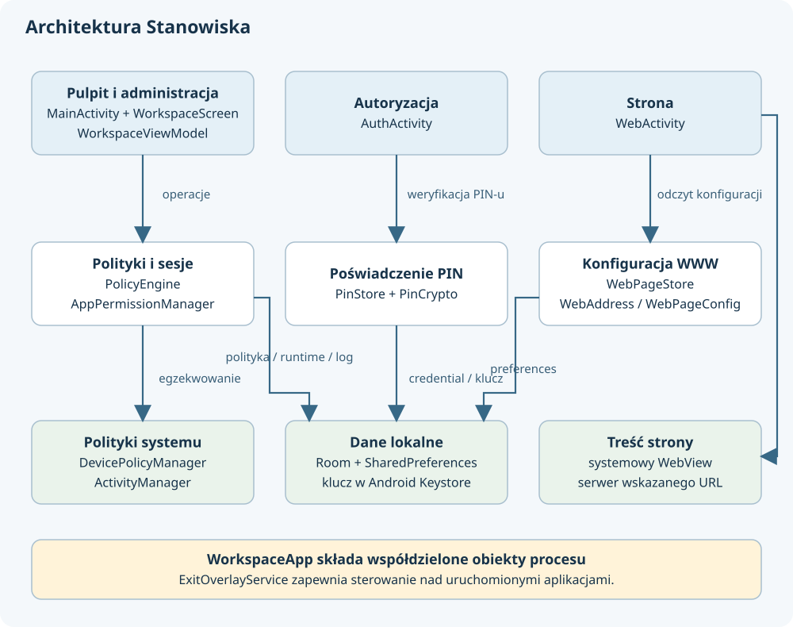

# 2. Architektura i mapa plików

## Podział odpowiedzialności

**Profesor pyta: jak podzielić aplikację w głowie, zanim zaczniemy czytać klasy?**

Na warstwę prezentacji, operacje dotyczące urządzenia oraz przechowywanie stanu. Podział jest logiczny; wszystkie klasy należą do jednego pakietu i jednego modułu Gradle. Kod przypomina MVVM, bo ekran obserwuje `WorkspaceViewModel`, lecz część działań ekran wywołuje bezpośrednio na usługach `WorkspaceApp`. Nie jest to konsekwentnie odizolowana Clean Architecture.

`WorkspaceApp` tworzy i udostępnia obiekty współdzielone w procesie. `WorkspaceViewModel` przechowuje stan prezentacji, obserwuje Room i opakowuje operacje w obsługę zajętości oraz błędów. `PolicyEngine` tłumaczy żądania na wywołania systemowego `DevicePolicyManager`. `PinStore` i `AppPermissionManager` obsługują własne obszary. Room i SharedPreferences przechowują dane lokalne.

Źródła: [WorkspaceApp.kt](../app/src/main/java/pl/adriantur/stanowisko/WorkspaceApp.kt), [WorkspaceViewModel.kt](../app/src/main/java/pl/adriantur/stanowisko/WorkspaceViewModel.kt), [PolicyEngine.kt](../app/src/main/java/pl/adriantur/stanowisko/PolicyEngine.kt).

**Profesor pyta: dlaczego zależności spotykają się w klasie Application?**

Android tworzy `WorkspaceApp` dla procesu aplikacji. Jej właściwości `by lazy` pozwalają uzyskać jedną instancję bazy, silnika, magazynu PIN-u i konfiguracji strony w tym procesie. Jest to ręczne składanie zależności. Nie ma Hilt, Dagger ani kontenera DI.

Zyskiem jest mała liczba elementów konfiguracji. Kosztem jest silne związanie klas z `WorkspaceApp` i Androidem. Na przykład testowanie `PolicyEngine` bez platformy wymagałoby wydzielenia interfejsu systemowych polityk. Samo `by lazy` nie zapewnia trwałości obiektu po zabiciu procesu.

## Trzy aktywności i nakładka

**Profesor pyta: dlaczego są trzy Activity?**

`MainActivity` jest pulpitem i gospodarzem ekranu administracyjnego. `AuthActivity` to oddzielny ekran autoryzacji dostępny z nakładki. `WebActivity` utrzymuje WebView we własnym zadaniu. Dzięki temu strona, pulpit i okno PIN-u mogą mieć osobne zachowanie powrotu i usuwania zadania.

| Komponent | Deklaracja i znaczenie |
| --- | --- |
| `MainActivity` | `exported=true`, `singleTask`, kategorie HOME i LAUNCHER; może być pulpitem Androida i zwykłą ikoną startową |
| `AuthActivity` | `exported=false`, `singleTask`, affinity `.auth`, wykluczenie z ostatnich zadań |
| `WebActivity` | `exported=false`, `singleTask`, affinity `.web`, wykluczenie z ostatnich zadań |
| `ExitOverlayService` | Prywatny foreground service typu `specialUse`, tworzący okno nad aplikacjami |
| `WorkspaceAdminReceiver` | Odbiornik administracyjny chroniony `BIND_DEVICE_ADMIN` |
| `BootReceiver` | Prywatny odbiornik uruchomienia systemu i aktualizacji własnego pakietu |

Źródło: [AndroidManifest.xml](../app/src/main/AndroidManifest.xml). Affinity określa powiązanie aktywności z zadaniami; nie tworzy osobnego procesu ani osobnego użytkownika Androida.

**Profesor pyta: które wejścia są dostępne innym aplikacjom?**

Manifest eksportuje pulpit i odbiornik administracyjny. Ten drugi wymaga systemowego uprawnienia `BIND_DEVICE_ADMIN`. Ekrany PIN-u i strony oraz usługa nakładki nie są eksportowane. Uruchomienie publicznego pulpitu nie nadaje autoryzacji administratora: wrażliwe metody sprawdzają `requireAdmin()` lub wymagają stanu polityki. Nie oznacza to automatycznego dowodu odporności wszystkich przepływów; warunki każdej operacji są omówione w rozdziałach 4 i 5.

## Wszystkie pliki Kotlin

**Profesor pyta: gdzie szukać konkretnej funkcji?**

Poniższa mapa obejmuje wszystkie 26 plików Kotlin aplikacji. W tabeli nazwa pliku prowadzi bezpośrednio do źródła.

| Plik | Odpowiedzialność i najważniejsze wejścia |
| --- | --- |
| [WorkspaceApp.kt](../app/src/main/java/pl/adriantur/stanowisko/WorkspaceApp.kt) | Składanie usług, inicjalizacja PIN-u, locale, cykl życia Activity, `authorized`, `requireAdmin`, `audit` |
| [MainActivity.kt](../app/src/main/java/pl/adriantur/stanowisko/MainActivity.kt) | Tworzenie ViewModelu, oczekiwanie na inicjalizację, `onResume` z `restore`, przekazywanie żądania uprawnień |
| [WorkspaceViewModel.kt](../app/src/main/java/pl/adriantur/stanowisko/WorkspaceViewModel.kt) | Strumienie polityki i logów, lista aplikacji, liczniki uprawnień, `refresh`, `run`, `notify` |
| [WorkspaceScreen.kt](../app/src/main/java/pl/adriantur/stanowisko/WorkspaceScreen.kt) | Panel i wybór widoku, formularz listy, dialog uprawnień, zapis i zastosowanie, zmiana PIN-u, serwis |
| [VisualDesign.kt](../app/src/main/java/pl/adriantur/stanowisko/VisualDesign.kt) | Motyw, tło, kafelki launchera, zegar, bateria, ikony rysowane w Canvas, komunikaty |
| [PolicyEngine.kt](../app/src/main/java/pl/adriantur/stanowisko/PolicyEngine.kt) | Lista programów, egzekwowanie i przywracanie polityki, uruchamianie sesji, zakończenie, serwis |
| [AppPolicy.kt](../app/src/main/java/pl/adriantur/stanowisko/AppPolicy.kt) | `AppRule`, kodowanie JSON, walidacja listy dozwolonych aplikacji |
| [WorkspaceDatabase.kt](../app/src/main/java/pl/adriantur/stanowisko/WorkspaceDatabase.kt) | Encje Room, DAO, baza wersji 3 i dwie migracje |
| [AuthActivity.kt](../app/src/main/java/pl/adriantur/stanowisko/AuthActivity.kt) | Sprawdzenie PIN-u, autoryzowany powrót, zakończenie sesji, przejście do uprawnień |
| [AdministratorPinField.kt](../app/src/main/java/pl/adriantur/stanowisko/AdministratorPinField.kt) | Pole cyfr z maskowaniem, klawiaturą PIN i limitem 12 znaków |
| [PinStore.kt](../app/src/main/java/pl/adriantur/stanowisko/PinStore.kt) | AES-GCM z Android Keystore, zapis credential, weryfikacja i liczniki prób |
| [PinCrypto.kt](../app/src/main/java/pl/adriantur/stanowisko/PinCrypto.kt) | Format PIN-u, PBKDF2 i obliczanie czasu blokady |
| [AppPermissions.kt](../app/src/main/java/pl/adriantur/stanowisko/AppPermissions.kt) | Model uprawnienia, walidacja zależności lokalizacji, kolejność zmian, weryfikacja i próba wycofania |
| [ExitOverlayService.kt](../app/src/main/java/pl/adriantur/stanowisko/ExitOverlayService.kt) | Powiadomienie usługi, okno, przeciąganie, przyciski, potwierdzenie gotowości |
| [FloatingPanelPosition.kt](../app/src/main/java/pl/adriantur/stanowisko/FloatingPanelPosition.kt) | Obliczenia granic, przycinanie pozycji i zapis współrzędnych jako ułamków |
| [WebPageConfig.kt](../app/src/main/java/pl/adriantur/stanowisko/WebPageConfig.kt) | Konfiguracja strony, normalizacja origin, walidacja adresów i magazyn preferences z StateFlow |
| [WebsiteSettings.kt](../app/src/main/java/pl/adriantur/stanowisko/WebsiteSettings.kt) | Formularz strony; przełącznik włączenia zapisuje od razu, inne pola przez przycisk |
| [WebActivity.kt](../app/src/main/java/pl/adriantur/stanowisko/WebActivity.kt) | WebView, kontrola nawigacji, odmowy dostępu do plików i urządzeń, obsługa awarii renderera |
| [BootReceiver.kt](../app/src/main/java/pl/adriantur/stanowisko/BootReceiver.kt) | Żądanie odtworzenia po BOOT_COMPLETED i MY_PACKAGE_REPLACED |
| [WorkspaceAdminReceiver.kt](../app/src/main/java/pl/adriantur/stanowisko/WorkspaceAdminReceiver.kt) | Rejestrowanie systemowego wejścia i wyjścia z Lock Task |
| [WindowProtection.kt](../app/src/main/java/pl/adriantur/stanowisko/WindowProtection.kt) | Pomocnicze ustawienie flagi niewygaszania oraz widoczności pasków okna |
| [BatteryStatus.kt](../app/src/main/java/pl/adriantur/stanowisko/BatteryStatus.kt) | Odczyt procentu i ładowania, odbiornik związany z cyklem życia Compose |
| [LenovoSystemMenu.kt](../app/src/main/java/pl/adriantur/stanowisko/LenovoSystemMenu.kt) | Rozpoznanie menu producenta na konkretnym TB311FU; tylko odczyt ustawienia |
| [UiText.kt](../app/src/main/java/pl/adriantur/stanowisko/UiText.kt) | Polskie nazwy stanów Lock Task oraz prezentacja zdarzeń audytowych |
| [WorkspaceError.kt](../app/src/main/java/pl/adriantur/stanowisko/WorkspaceError.kt) | Własny wyjątek, sprawdzanie warunków, bezpieczny komunikat dla użytkownika |
| [WorkspaceNotice.kt](../app/src/main/java/pl/adriantur/stanowisko/WorkspaceNotice.kt) | Typ komunikatu i zasada jego wygaszania |

## Skąd biorą się klasy i wywołania

**Profesor pyta: gdzie jest funkcja main uruchamiająca całą aplikację?**

Własny kod nie rozpoczyna się tutaj od zwykłego `fun main()`. Android odczytuje manifest, tworzy wskazaną klasę `WorkspaceApp` i uruchamia odpowiedni komponent. Dotknięcie ikony kieruje do `MainActivity` dzięki filtrowi LAUNCHER, wybór pulpitu korzysta z HOME, a zdarzenie startu systemu trafia do odbiornika. Metody `onCreate`, `onResume`, `onReceive` i `onStartCommand` są punktami wywoływanymi przez platformę. Dlatego do zrozumienia kolejności trzeba czytać manifest i cykl życia, a nie szukać jednego liniowego programu.

**Profesor pyta: skąd pochodzą importy, skoro wielu klas nie ma w repozytorium?**

`android.*` to API platformy udostępnione do kompilacji przez SDK, a realizowane na urządzeniu przez Androida. `androidx.*` pochodzi z bibliotek AndroidX zadeklarowanych bezpośrednio lub przechodnio w Gradle. `kotlinx.coroutines.*` pochodzi z korutyn, `java.*` i `javax.crypto.*` z odpowiednich API biblioteki standardowej i platformy. `pl.adriantur.stanowisko.*` to własny pakiet projektu. Sam `import` jedynie pozwala używać krótszej nazwy klasy; nie pobiera i nie instaluje zależności. Pobieranie rozstrzyga Gradle, a dostępność platformowych API także minSdk i compileSdk.

**Profesor pyta: dlaczego używamy R.string, choć nie ma pliku R.kt?**

Klasa `R` jest generowana z zasobów w `res`. Nazwa `R.string.error_operation` identyfikuje tekst w `strings.xml`, a `getString(...)` odczytuje go dla kontekstu i konfiguracji językowej. Analogicznie `R.drawable` identyfikuje ikony. Tych identyfikatorów nie wpisujemy ręcznie jako stałych liczbowych. Room również tworzy kod, ale przez KSP i na podstawie encji oraz DAO. W obu przypadkach autor utrzymuje źródło deklaracji, a generator buduje potrzebną implementację lub identyfikatory.

**Profesor pyta: co oznaczają by lazy, remember i suspend w tym projekcie?**

`by lazy` tworzy wartość przy pierwszym użyciu i zapamiętuje ją w danej instancji obiektu; tak `WorkspaceApp` udostępnia usługi. `by viewModels` uzyskuje ViewModel związany z właścicielem Androida zamiast tworzyć nowy obiekt przy każdym przerysowaniu. `remember` zachowuje stan w żyjącej kompozycji UI, ale nie jest zapisem na dysku. To trzy różne zakresy życia.

`suspend` oznacza funkcję zdolną do zawieszenia pracy korutyny; nie gwarantuje samoistnego wykonania na wątku tła. Dopiero `withContext(Dispatchers.IO)` przełącza odpowiedni fragment na pulę dla IO, a `delay` zawiesza oczekiwanie. `LaunchedEffect` uruchamia zadanie związane z życiem elementu Compose i jego kluczami, `DisposableEffect` pozwala sprzątnąć zewnętrzny efekt, a `collectAsStateWithLifecycle` łączy strumień ze stanem ekranu. Te konstrukcje tłumaczą, dlaczego dane mogą się zmieniać bez ręcznego przerysowywania całej listy.

## Pliki poza Kotlinem

**Profesor pyta: co jeszcze bierze udział w działaniu?**

| Plik lub katalog | Rola |
| --- | --- |
| [settings.gradle.kts](../settings.gradle.kts) | Nazwa `Stanowisko`, moduł `:app`, repozytoria pluginów i bibliotek |
| [build.gradle.kts](../build.gradle.kts) | Wersje pluginów AGP, Compose compiler i KSP |
| [app/build.gradle.kts](../app/build.gradle.kts) | API, wersja produktu, Java/Kotlin target, Compose i biblioteki |
| [gradle.properties](../gradle.properties) | Maksymalna sterta Gradle 3 GB, kodowanie UTF-8 i AndroidX |
| [gradle/wrapper](../gradle/wrapper/gradle-wrapper.properties) | Wrapper Gradle 9.1.0 z sumą archiwum dystrybucji |
| [gradlew](../gradlew), [gradlew.bat](../gradlew.bat) | Start właściwej wersji Gradle na Unix i Windows |
| [app/schemas](../app/schemas/pl.adriantur.stanowisko.WorkspaceDatabase/3.json) | Eksporty kontraktu bazy wersji 1–3; nie są bazą z danymi użytkownika |
| [manifest debug](../app/src/debug/AndroidManifest.xml) | `testOnly=true` dla wariantu rozwojowego |
| [strings.xml](../app/src/main/res/values/strings.xml) | Polskie teksty, komunikaty, opisy dostępności i nazwa aplikacji |
| [styles.xml](../app/src/main/res/values/styles.xml) | Bazowy motyw okien Androida, niezależny od funkcji motywu Compose |
| [device_admin.xml](../app/src/main/res/xml/device_admin.xml) | Metadane odbiornika administracyjnego; pusty `uses-policies` nie nadaje Device Owner |
| [locale_config.xml](../app/src/main/res/xml/locale_config.xml) | Zadeklarowany język polski |
| [data_extraction_rules.xml](../app/src/main/res/xml/data_extraction_rules.xml) | Wyłączenie eksportu danych w backupie i transferze urządzenia |
| `res/drawable/ic_*.xml` | Pięć ikon wektorowych: aplikacja, administrator, przesuwanie, dom i kłódka |
| [install.sh](../install.sh), [install.ps1](../install.ps1) | Pobieranie gotowego APK, kontrola sumy, ADB i opcjonalne przygotowanie właściciela |
| [.gitignore](../.gitignore) | Wykluczenie cache, buildów, ustawień lokalnych, kluczy i APK |
| [.editorconfig](../.editorconfig), [.gitattributes](../.gitattributes) | Kodowanie, wcięcia i zakończenia linii; JAR jest plikiem binarnym |

`local.properties` wskazuje lokalny SDK i jest ignorowany przez Git. `.idea`, `.gradle`, `.kotlin` oraz `app/build` zawierają stan środowiska lub wyniki narzędzi. Nie należy ich traktować jako osobnych warstw architektury ani ręcznie utrzymywanego kodu aplikacji.

**Profesor pyta: jak czytać kod w sensownej kolejności?**

Najpierw manifest, następnie `WorkspaceApp`, `MainActivity`, `WorkspaceViewModel` i `AppPolicy`. Potem model bazy i najważniejsze metody `PolicyEngine`: `save`, `apply`, `launch`, `restore`, `endSession`, `serviceExit`. Dopiero wtedy ekran administracyjny, PIN, uprawnienia i WebView. W tej kolejności znamy już znaczenie obiektów, na które natrafimy w dużych plikach UI.

Przy zmianie jednej funkcji idziemy po konkretnej ścieżce. Przykładowo nowe ustawienie ekranu wymaga przemyślenia formularza, zapisu, kopii zastosowanej, migracji, runtime, przywracania i serwisu. Sama nowa kontrolka nie kończy implementacji.
