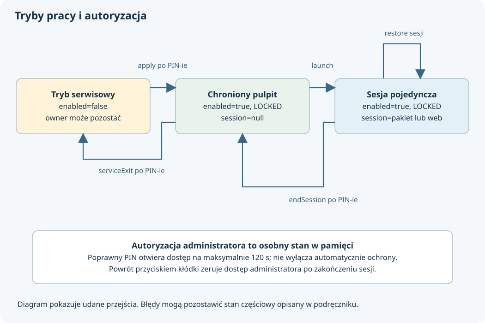
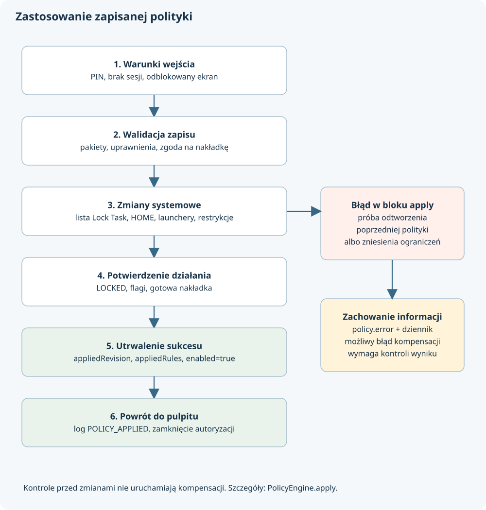

# 4. Egzekwowanie polityki i przebiegi operacji

## Warunki chronionej pracy

**Profesor pyta: jakie trzy stany najłatwiej pomylić?**

Rolę właściciela urządzenia, intencję utrzymywania ochrony i rzeczywisty stan Lock Task. W kodzie odpowiadają im `engine.owner`, `PolicyRecord.enabled` i `engine.lockState`. Kafelek pulpitu pokazuje pełną ochronę dopiero dla połączenia: właściciel, aktywna polityka i `LOCK_TASK_MODE_LOCKED`.

| Warunek | Co mówi | Czego sam nie zapewnia |
| --- | --- | --- |
| `owner == true` | System uznaje Stanowisko za Device Owner | Że zastosowano konfigurację |
| `enabled == true` | Aplikacja ma utrzymywać i odtwarzać politykę | Że wszystkie wywołania Androida właśnie się powiodły |
| `lockState == LOCKED` | System działa w blokowanym trybie zadań | Że zapisany szkic jest już zastosowany |
| `session != null` | Trwa sesja jednej aplikacji lub strony | Że użytkownik ma dostęp administratora |
| `authorized() == true` | Nie minął termin autoryzacji w procesie | Że zniesiono ograniczenia urządzenia |

Wszystkie opisane niżej metody znajdują się w [PolicyEngine.kt](../app/src/main/java/pl/adriantur/stanowisko/PolicyEngine.kt), o ile nie wskazano innego pliku.

## Zapis i zastosowanie

**Profesor pyta: co robi save?**

Pod blokadą mutexu sprawdza autoryzację, waliduje reguły względem aktualnej listy programów i dostępności strony, pobiera poprzedni rekord albo tworzy domyślny. Zapisuje numer rewizji powiększony o jeden, nowe reguły i dwie opcje ekranu. Czyści `error` i dopisuje `POLICY_SAVED`. Nie ustawia `enabled=true` ani nie wywołuje `startLockTask()`.

**Profesor pyta: co dokładnie robi przycisk zastosowania?**

`apply(activity)` wykonuje następujący przebieg:

1. Sprawdza administratora, skonfigurowany PIN, brak aktywnej sesji pojedynczej i odblokowany ekran Androida.
2. Odczytuje zapisaną politykę, dekoduje JSON i ponownie sprawdza dostępność aplikacji.
3. Wymaga przygotowanych uprawnień wszystkich wybranych pakietów i zezwolenia na nakładkę.
4. `setPolicy()` ustawia reguły w Androidzie, HOME, ukrycie innych pulpitów i trzy ograniczenia użytkownika.
5. `startProtection()` wywołuje `startLockTask()` na aktywności i czeka na `LOCK_TASK_MODE_LOCKED`.
6. Utrwala zastosowane flagi ekranu w runtime i ustawia własne okno.
7. Uruchamia nakładkę i czeka na jej potwierdzenie gotowości.
8. Ponownie sprawdza stan Lock Task i dopiero wtedy zapisuje zastosowaną kopię polityki z `enabled=true`.
9. Dodaje `POLICY_APPLIED` z numerem rewizji. Kod UI zamyka bieżącą autoryzację administratora.

**Profesor pyta: dlaczego walidujemy drugi raz, skoro save już sprawdziło listę?**

Między zapisem a zastosowaniem aplikację można usunąć, zaktualizować lub zmienić konfigurację WWW. Walidacja przy zapisie zapewnia poprawność szkicu w tamtym momencie. Walidacja przy zastosowaniu dotyczy stanu bieżącego. Jeszcze inną rolę ma kontrola wyniku systemowego po zmianie.

## Operacje systemowe

**Profesor pyta: co naprawdę ustawia setPolicy?**

Lista Lock Task zawsze zawiera pakiet Stanowiska. Dodatkowe pakiety pochodzą z przekazanych reguł. Silnik ustawia persistent preferred HOME na `MainActivity`, ukrywa inne launchery i dodaje `DISALLOW_SAFE_BOOT`, `DISALLOW_ADD_USER` oraz `DISALLOW_CONFIG_DATE_TIME`.

Opcje Lock Task są składane jako maska bitowa:

| `single` | `hideBars` | Włączane cechy |
| --- | --- | --- |
| false | false | BLOCK_ACTIVITY_START_IN_TASK, HOME, SYSTEM_INFO |
| false | true | BLOCK_ACTIVITY_START_IN_TASK |
| true | false | BLOCK_ACTIVITY_START_IN_TASK, SYSTEM_INFO |
| true | true | BLOCK_ACTIVITY_START_IN_TASK |

Zablokowanie uruchamiania niedozwolonych aktywności w zadaniu jest więc włączane zawsze. Obsługa HOME jest dodawana tylko dla trybu wielu aplikacji przy widocznych paskach. Kod nie dodaje cech OVERVIEW ani NOTIFICATIONS. Następnie odczytuje listę pakietów, maskę i aktualny HOME, porównując je z oczekiwaniem. Nie odczytuje w tym samym warunku weryfikacyjnym każdej dodanej restrykcji użytkownika.

**Profesor pyta: dlaczego zachowujemy poprzedni stan obcych pulpitów?**

`secureOtherLaunchers()` wyszukuje HOME, pomija własny pakiet i kandydatów z ujemnym priorytetem. W `runtime.hiddenLaunchers` zapisuje mapę pakiet→poprzednia widoczność, zanim rozpocznie ukrywanie. Dzięki temu wyjście serwisowe może odtworzyć poprzedni stan, także jeśli aplikacja została w międzyczasie uruchomiona ponownie. Nie zakłada, że każdy launcher był początkowo widoczny.

Przywracanie poprzedniego stanu ukrycia jest jawnie modelowane. Dla trzech restrykcji użytkownika analogicznej kopii stanu początkowego nie ma: serwis je usuwa. Ten szczegół ma znaczenie przy rozszerzaniu zestawu polityk.

**Profesor pyta: po co pamiętamy korzeń zadania?**

`startProtection()` zapisuje `taskId` i słabą referencję do Activity uruchamiającej Lock Task. `attach()` może podpiąć nową instancję Activity tego samego zadania. Słaba referencja nie utrzymuje starego ekranu przy życiu. To potrzebne przy wychodzeniu, ponieważ `stopLockTask()` ma znaczenie w kontekście aktywności, która rozpoczęła tryb. Zachowanie platformy opisuje [dokumentacja zatrzymywania Lock Task](https://developer.android.com/work/dpc/dedicated-devices/lock-task-mode#stop_lock_task_mode).

Silnik czeka na zmianę stanu maksymalnie 5 sekund, odczytując stan co 50 ms. To asynchroniczne oczekiwanie korutyny, a nie blokowanie wątku przez `Thread.sleep()`.

## Błąd zastosowania

**Profesor pyta: co dzieje się, jeśli Android odrzuci część zmian?**

W bloku obsługi błędu `apply()` podejmuje próbę wycofania. Jeśli poprzednia polityka była aktywna, odtwarza `appliedRules`, flagi i nakładkę. Jeśli nie była aktywna, wyłącza własne flagi i usługę, próbuje zakończyć Lock Task, czyści listę, persistent HOME, przywraca launchery i usuwa trzy restrykcje.

Błąd samego wycofania dopisuje jako suppressed exception i rejestruje `POLICY_ROLLBACK_ERROR`. Następnie zachowuje pierwotny rekord polityki z opisem błędu, loguje `POLICY_ERROR` i przekazuje wyjątek wyżej. UI prezentuje komunikat przez ViewModel.

To **próba kompensacji skutków**, nie transakcja systemowa z gwarancją pełnego cofnięcia. Warunki sprawdzane przed blokiem `try`, np. brak uprawnień czy nakładki, nie uruchamiają tej ścieżki wycofywania, bo zmiany systemowe nie zostały jeszcze rozpoczęte przez tę operację.

## Uruchomienie aplikacji i sesja

**Profesor pyta: co dzieje się po naciśnięciu kafelka programu?**

`launch()` wymaga braku innej sesji i znajduje dokładnie jedną regułę dla pakietu. Przy aktywnej polityce korzysta z `appliedRules`, w pozostałym przypadku z zapisanych `rules`. Pobiera systemowy Intent uruchomienia.

Jeżeli ochrona jest wyłączona albo nie ma Device Owner, zwykłą regułę wieloaplikacyjną można uruchomić bez pełnej ochrony. Reguła pojedynczej sesji zostanie wtedy odrzucona. To użyteczna możliwość demonstracji pulpitu, ale jej stan jest jawnie oznaczony jako brak pełnej ochrony.

Przy ochronie silnik wymaga przygotowanych uprawnień. Dla sesji pojedynczej najpierw uruchamia nakładkę w trybie kłódki, zapisuje nazwę pakietu w `runtime.session`, zawęża politykę i uruchamia program z `NEW_TASK | CLEAR_TASK`. `CLEAR_TASK` oznacza możliwość usunięcia dotychczasowego stosu aktywności zadania; nie oznacza kasowania danych aplikacji z dysku. Zwykłe uruchomienie także w tej chronionej ścieżce otrzymuje te flagi.

**Profesor pyta: jak wygląda sesja strony?**

`launchWeb()` wymaga włączonej, poprawnej strony oraz aktywnej ochrony z Device Owner. W pojedynczej sesji zapisuje specjalny znacznik `stanowisko:web` i ustawia listę tylko z własnym pakietem. W wielu aplikacjach odtwarza listę zastosowanych reguł. Uruchamia `WebActivity` w osobnym zadaniu. Nie dodaje pakietu przeglądarki do listy: WebView jest widokiem wewnątrz Stanowiska.

## Powrót i odtwarzanie

**Profesor pyta: jak kończy się sesję jednej aplikacji?**

Nakładka otwiera `AuthActivity`. Po poprawnym PIN-ie aktywna sesja jest kończona przez `endSession()`: silnik tymczasowo pozostawia na liście Lock Task tylko własny pakiet, przywraca reguły wielu aplikacji, usuwa `runtime.session` i aktualizuje nakładkę. Dla strony dodatkowo usuwa jej zadanie z `appTasks`.

PIN pozwalający wyłącznie wrócić do pulpitu (`EXTRA_RETURN_DESKTOP`) nie zostawia otwartego panelu administratora: autoryzacja jest zerowana przed przejściem. Zwykłe wejście przez przycisk administratora może otworzyć panel. Szczegóły zawiera [AuthActivity.kt](../app/src/main/java/pl/adriantur/stanowisko/AuthActivity.kt).

**Profesor pyta: czy po restarcie trzeba zapisać konfigurację od nowa?**

Nie. `BootReceiver` dla uruchomienia systemu lub wymiany własnego pakietu sprawdza Device Owner i `enabled`, po czym prosi o otwarcie pulpitu. Główne odtwarzanie wykonuje `MainActivity.onResume()` przez `restore()`.

`restore()` korzysta z **zastosowanych**, a nie dopiero zapisanych reguł. Dla sesji natywnej wybiera jej jeden pakiet, dla sesji WWW pustą listę dodatkowych pakietów, a przy braku sesji pełne `appliedRules`. Odtwarza politykę, Lock Task, flagi i nakładkę; następnie próbuje otworzyć cel sesji. Przy zablokowanym keyguardzie odkłada działania do późniejszego wywołania. Błąd zachowuje z prefiksem `Odtwarzanie:` i loguje `RESTORE_ERROR`.

To mechanizm ponawiany przy powrocie pulpitu, nie stały watchdog i nie obietnica natychmiastowego przywrócenia w każdym wariancie oprogramowania producenta. [BootReceiver.kt](../app/src/main/java/pl/adriantur/stanowisko/BootReceiver.kt) używa `goAsync()` i kończy pracę `pending.finish()`.

## Wyjście serwisowe

**Profesor pyta: czym wyjście serwisowe różni się od zamknięcia panelu?**

Zamknięcie panelu zeruje autoryzację. `serviceExit()` zmienia politykę urządzenia: wymaga administratora i braku sesji, zapisuje `enabled=false`, wyłącza flagi oraz nakładkę, próbuje zakończyć Lock Task i przywraca środowisko systemowe.

Jeśli korzeń zadania jest niedostępny lub `stopLockTask()` nie zadziała, po próbie oczekiwania do 1,5 sekundy silnik odbiera pakietom allowlistę, a następnie sprawdza stan. Czyści persistent HOME, odtwarza zapisane ukrycie pulpitów i usuwa trzy restrykcje. **Nie usuwa Device Owner i nie przywraca wcześniejszych decyzji o uprawnieniach aplikacji.** Nie czyści zapisanej konfiguracji ani PIN-u.

Wcześniejszy zapis `enabled=false` zapobiega automatycznemu ponownemu nakładaniu ochrony po restarcie. Jednocześnie awaria w środku tego procesu może pozostawić część systemowych ograniczeń przy wyłączonym zamiarze odtwarzania; dlatego stan serwisu trzeba potwierdzić na urządzeniu.
